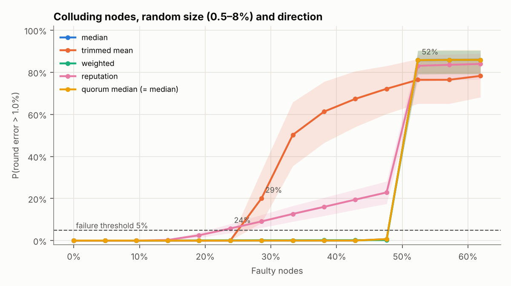
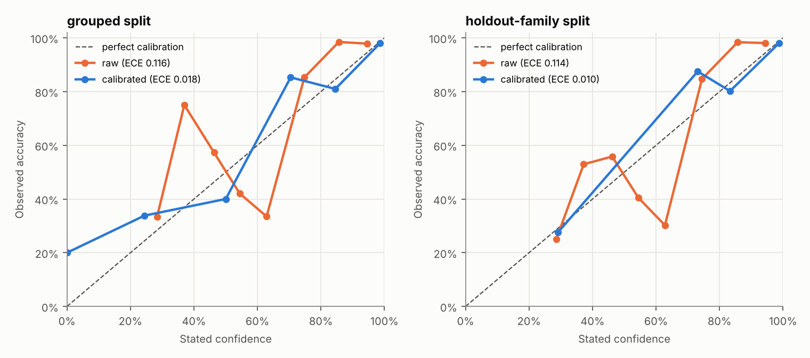

# OracleLens

A reproducible laboratory for decentralized oracle reliability. OracleLens simulates oracle networks, injects labelled failures and attacks, detects and diagnoses them, and measures **when each defense stops working**.

> Independent research project inspired by decentralized oracle reliability challenges. Not affiliated with Chainlink or any oracle provider, and not a claim about any production system. All thresholds are research benchmarks, not safety limits.

## Quick start

```bash
pip install -e ".[dev]"
python -m pytest                                   # 30 tests
python -m oraclelens.lab                           # dashboard + live lab at http://127.0.0.1:8000
python -m oraclelens.run --config experiments/mixed_faults.yaml --seed 42
./reproduce.sh                                     # every result below, ~7 minutes
```

## Dashboard

`python -m oraclelens.lab` opens a dashboard with five views:

- **Findings:** the headline results in one page.
- **Breaking points:** every sweep, switchable by scenario and error tolerance, with confidence bands and availability.
- **Diagnosis:** reliability diagrams, calibration metrics and the cause-attribution confusion matrix.
- **Mango case study:** the price each defense would have used and how much the attacker could borrow.
- **Live lab:** build an attack (12 fault types), run it, then scrub round by round through a node × round heatmap (ground truth, deviation, or any detector's hits and false alarms), inspect each node's report in a single round, and read the diagnosis engine's explanation of every incident. Scenarios can be copied out as YAML for the CLI.

A static copy of the first four views (no server needed) is written to `docs/index.html` by `python -m oraclelens.lab.export`. To publish it, enable GitHub Pages for this repository from the `main` branch, `/docs` folder.

Every run is defined by a YAML config plus a seed and writes a self-contained folder:

```
runs/<name>/seed<seed>_<config-hash>/
  config.json          resolved config
  provenance.json      config hash, data hash, seed, versions, input provenance
  metrics.json         aggregation, detection, slow-burn and attribution metrics
  events.parquet       every node report: truth, value, latency, label, detector flags
  predictions.parquet  every aggregate and its error
  incidents.parquet    every diagnosed incident with probabilities and features
  report.md            human-readable incident report
```

No database is needed to reproduce anything.

Fault parameters can be fixed numbers or distributions, drawn once per seed:

```yaml
faults:
  - type: collusion
    count: 4
    bias: {uniform: [0.005, 0.08]}     # also: loguniform, normal, choice
    direction: {choice: [-1, 1]}
    start: {uniform: [50, 150]}        # integer parameters are rounded
```

The drawn values are saved in each run's events, and a seed always produces the same attack regardless of how many attackers are used, so sweep curves compare like with like.

## What is built

| Layer | Contents |
| --- | --- |
| Prices | Synthetic jump-diffusion, explicit series, or historical CSV/Parquet replay with SHA-256 and manifest provenance |
| Simulator | 10–30+ nodes, per-exchange shared errors, intra-round timing lag, lognormal latency with a deadline, packet loss |
| Fault library | outlier, collusion, slow-burn, drift, stale, replay, offline, partition, delay, source fault, flash spike, legitimate market shock (control). Every fault writes ground-truth labels |
| Detectors | MAD, Hampel, rolling baseline, robust CUSUM, volatility-aware MAD (all causal) |
| Aggregators | median, 20% trimmed mean, inverse-error weighted mean, long-memory reputation-weighted mean, quorum median |
| Diagnosis | 8-class cause attribution (none + 7 causes) with probabilities, an *insufficient evidence* abstention, and plain-language explanations that state what could not be established |
| Evaluation | precision, recall, FPR, detection latency, aggregation error, availability, breaking points with bootstrap CIs, slow-burn damage before detection, ECE, Brier, reliability diagrams |
| Case study | Mango Markets–style collateral pump ([docs/case_study_mango.md](docs/case_study_mango.md)) |

## Definitions (fixed before running experiments)

- Relative error: `E_t = |P̂_t − P_t| / P_t`
- Failed round: `E_t > 1%` (also reported at 0.5% and 2%)
- Breaking point: `f* = min{ f : P(E_t > 1%) > 5% }`, estimated over 30 seeds with a 95% bootstrap interval over seeds
- Slow-burn success: first round after defection with `E_t > 1%`; "never" is recorded as never
- Calibration: scenarios are split **as whole scenarios**, never as rows, so similar incidents cannot leak between fitting and testing

## Results

Setup: 21 nodes, 5 exchanges, 500 rounds, 30 seeds per point.

### Claim 1: which aggregators tolerate faulty nodes?

Breaking point (share of faulty nodes) at a 1% tolerance. Attack sizes, directions and timing are **randomized per seed**; brackets show the 95% bootstrap interval where it is not a single value. Fixed-size versions of each sweep and the 0.5% and 2% tolerances are in [results/breaking_points.md](results/breaking_points.md).

| Scenario | Median | Trimmed mean | Inverse-error weighted | Reputation-weighted | Quorum median |
| --- | --- | --- | --- | --- | --- |
| Independent random errors (2–20%) | never (≤62%) | 33% | never | 24% | never |
| Collusion, 0.5–8% either direction | 52% | 29% | 52% | **24% [24–29%]** | 52% |
| Gradual slow-burn, random trust period and speed | 52% | 29% [29–33%] | 52% | 43% [38–48%] | 52% |
| Reputation exploit (trusted, then fast defection) | 52% | 29% | 52% | **29% [24–29%]** | 52% |
| Failing exchanges, 1–6% error (share of nodes affected) | 62% [62–81%] | 43% | 62% [62–81%] | 43% [43–81%] | 62% [62–81%] |
| Network partition | never | never | never | never | never (but stops answering at 33% offline) |

- **Long-memory reputation weighting gave up about half of the median's tolerance.** Trusted attackers kept full weight for many rounds after defecting. Inverse-error weighting did not have this problem, because a large deviation instantly cuts its weight.
- **The conclusions survive randomization.** Randomizing attack size, direction and timing moved trimmed-mean breaking points earlier (33% → 29%, because some draws reached 8%) but left the ranking unchanged.
- The median breaks at 11 of 21 nodes, as theory predicts, so its interval stays a single value: this breaking point is structural. Intervals are also coarse because the attacker count moves in steps of one node (about 5%).
- Results are sensitive to the tolerance for reputation weighting (10%–57% across 0.5%–2%) but not for the median.



### Claim 2: can slow-burn and correlated attacks evade detection?

- Against 5 slow-burn attackers (`experiments/slow_burn.yaml`), MAD flagged the attackers 9 rounds after defection; the median never reached 1% error because 5 of 21 is below the breaking point.
- A robust CUSUM catches small drift with near-zero false positives, but during development a version with a fixed noise scale raised false alarms on *honest* nodes when 30% of nodes colluded, because the colluders shifted the consensus. Detectors that compare against consensus inherit consensus contamination; the shipped CUSUM uses a per-round robust scale for this reason.
- Failing exchanges look like collusion unless the diagnoser knows which node reads which exchange. OracleLens assumes it does; real networks may not publish this.

### Claim 3: does the diagnosis know when it lacks evidence?

200 random scenarios (1–3 faults each, 30% with legitimate market shocks), 6,500+ incidents. An isotonic calibration map is fitted on training scenarios and evaluated on held-out scenarios.

| Split | Raw ECE | Calibrated ECE | Brier (raw → calibrated) | Coverage | Accuracy when it commits |
| --- | --- | --- | --- | --- | --- |
| Random grouped split | 0.116 | **0.018** | 0.137 → 0.104 | 90% | 97% |
| Held-out families (replay, flash spike never seen in training) | 0.114 | **0.010** | 0.139 → 0.105 | 90% | 97% |

- The hand-set rule confidences were **miscalibrated** (ECE 0.12); calibration on held-out scenarios fixed this and generalized to unseen attack families.
- Weakest classes: stale (83–86% top-1) and isolated outliers, which most often end as *insufficient evidence*.



### Case study: Mango Markets–style pump

All nodes honestly reported the manipulated price, so consensus detection never fired. A volatility circuit breaker prevented ~99.6% of the modeled loss but paused honest borrowing for an hour after a legitimate +25% jump. Combining TWAP with the breaker prevented *less* than the breaker alone. Full write-up, assumptions and sources: [docs/case_study_mango.md](docs/case_study_mango.md).

## Limitations

- Simulated nodes and markets simplify real operators, exchanges and networks; results hold for these models.
- Attacker counts move in whole nodes, so breaking points are resolved only to about 5% with 21 nodes; larger networks would sharpen this.
- The attribution rules were developed while looking at the same simulator they are scored on. The held-out-family split reduces, but does not remove, this optimism.
- No historical dataset is bundled. The loader and provenance are built; add a CSV with a `price` column and a `<file>.manifest.json`, then set `price.mode: historical`.

## Not yet built (from the spec)

Heartbeat/deviation-threshold publishing, live WebSocket streaming (the lab runs a whole simulation, then replays it), PDF export (reports are Markdown), and the Solidity/Hardhat layer.

## Layout

```
oraclelens/        engine: config, prices, simulator, detectors, aggregators, diagnosis, metrics
  run.py           single experiment CLI
  sweep.py         breaking-point sweeps
  summary.py       breaking-point table across all sweeps
  params.py        randomized fault parameters
  calibrate.py     held-out calibration experiment
  casestudies/     Mango case study
  lab/             dashboard: FastAPI server, static export, single-page app
experiments/       YAML configs
tests/             pytest suite
results/           generated sweep, calibration and case-study outputs
docs/              case-study write-up and the static dashboard (index.html)
```
